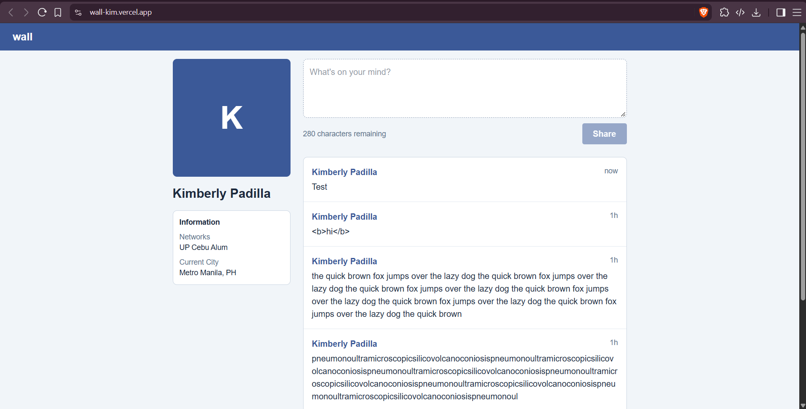
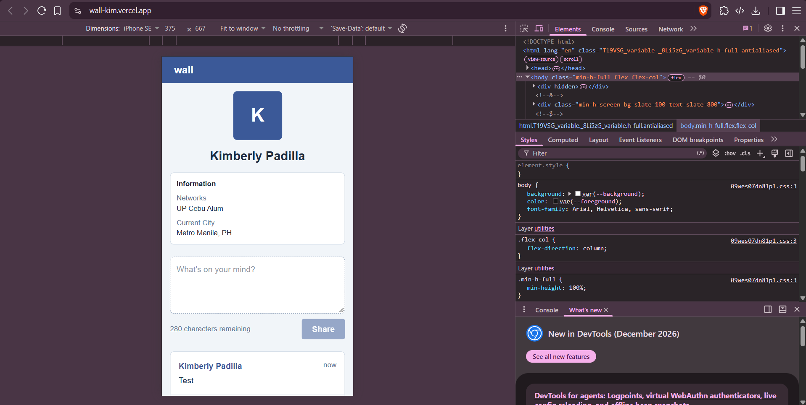

# 🧱 My Wall

A 2008 Facebook-style Wall. Type a message, press Share, and it's saved in Supabase and shown in a live feed, newest first.

**Live demo:** https://wall-kim.vercel.app/




## Features

- Post a message of up to 280 characters with a live character counter
- Posts are saved in Supabase and still there after a refresh
- Feed shows the latest 50 posts, newest first
- Realtime updates: new posts appear without refreshing (Supabase Realtime)
- Loading, empty, and error states
- Share is disabled for empty posts and while a post is sending
- Long words wrap inside the card, and post text is shown as plain text (React escapes HTML)
- Responsive layout with a 2008 Facebook-inspired look

## Tech Stack

- [Next.js](https://nextjs.org/) (App Router)
- React
- TypeScript
- Tailwind CSS
- [Supabase](https://supabase.com/) (Postgres + Realtime)
- Deployed on Vercel

## Database

One `posts` table. Row Level Security is on, and anonymous visitors can only read and add posts (no edit or delete). The 280-character limit is also enforced in the database.

```sql
create table public.posts (
  id uuid primary key default gen_random_uuid(),
  author text not null,
  body text not null check (char_length(body) between 1 and 280),
  created_at timestamptz not null default now()
);

alter table public.posts enable row level security;

create policy "Anyone can read posts"
  on public.posts for select to anon using (true);

create policy "Anyone can add posts"
  on public.posts for insert to anon with check (true);

alter publication supabase_realtime add table public.posts;
```

## Run Locally

```bash
git clone https://github.com/kapadilla/wall.git
cd wall
npm install
```

Create a `.env.local` file in the project root:

```
NEXT_PUBLIC_SUPABASE_URL=your-project-url
NEXT_PUBLIC_SUPABASE_ANON_KEY=your-anon-or-publishable-key
```

Then start the app:

```bash
npm run dev
```

Open [http://localhost:3000](http://localhost:3000).

## Project Structure

```
app/            Next.js app (layout, page, styles)
components/     Wall (feed, input, realtime logic)
lib/supabase.ts Supabase client and Post type
lib/time.ts     "2h ago" style timestamps
```

## How I Used AI

- Used Claude to plan the Supabase setup and generate the first version of the components, the SQL, and the realtime logic.
- I set up the project, ran and tested everything myself, and customized the layout, profile info, and styling.
- Things I ran into and fixed along the way:
  - A long word with no spaces stretched the feed and broke the layout. Fixed with `min-w-0` on the feed and `overflow-wrap: anywhere` on the post text.
  - The avatar and name were left-aligned and too big on mobile, so I centered them on small screens and shrank the avatar.
- Tested by hand: refresh persistence, newest first, empty posts, the 280 limit, long words, HTML input like `<b>hi</b>` showing as plain text, double-clicking Share, and Realtime across two tabs.

## Notes

- No login, so every post uses a fixed author name.
- The feed loads the latest 50 posts. Older posts stay in the database.

## What I'd Improve With More Time

- Photo upload with Supabase Storage
- Simple login so each person posts under their own name
- "Load more" pagination for older posts
- Rate limiting to prevent spam